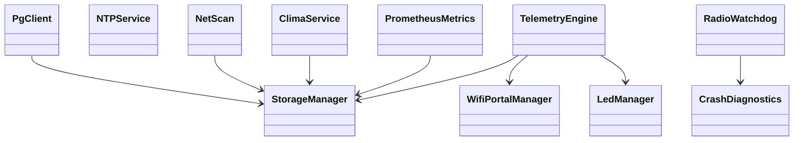
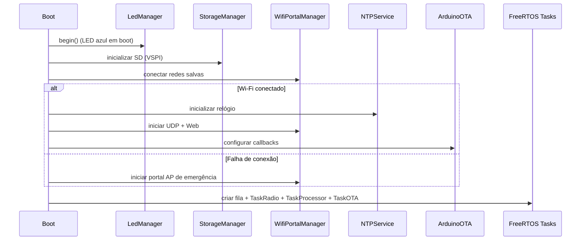
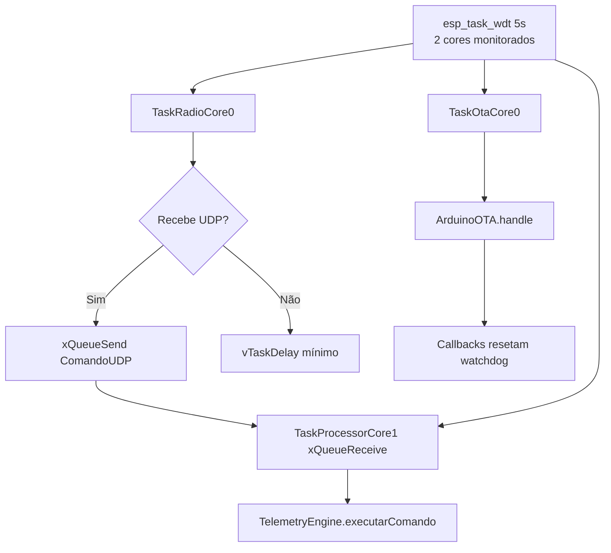
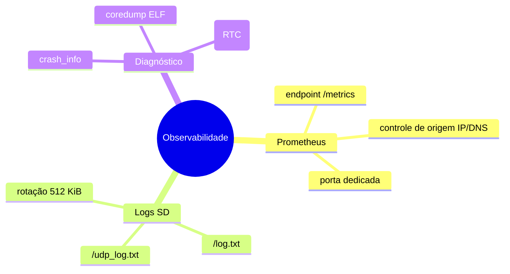
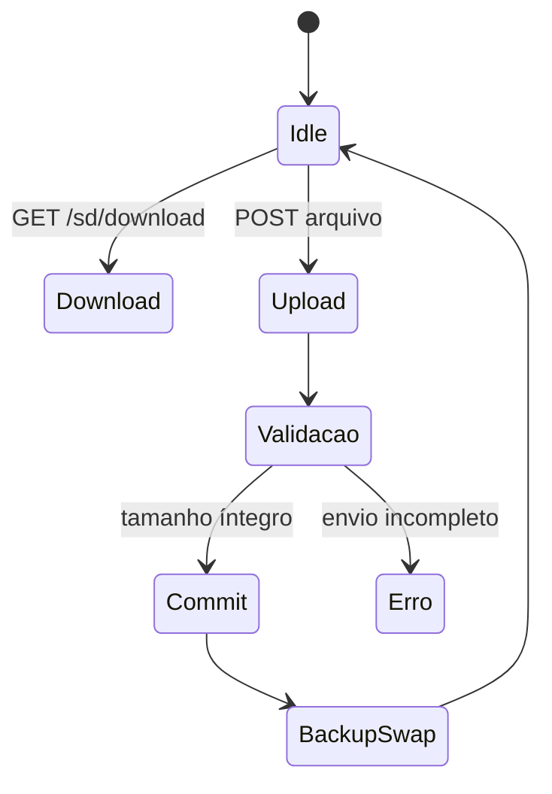

# 🐙 ESP32 Octopus — Premium IoT Firmware Platform

<div align="center">


Firmware **v1.4.3** para ESP32 com arquitetura modular, multitarefa nativa (FreeRTOS), controle remoto por UDP, painel web, OTA, telemetria Prometheus, varredura de rede e integração PostgreSQL.

</div>

---

## ✨ Visão geral

O **Octopus** é um firmware orientado a operação contínua em dispositivos ESP32, com foco em:

- observabilidade (métricas + logs);
- robustez (watchdog, isolamento por tasks, diagnóstico de crash);
- gerência remota (UDP + web + OTA);
- persistência local (SD) e integração externa (PostgreSQL).

### 🔭 Capacidades principais

- ✅ **Dual-core FreeRTOS** com tarefas dedicadas para rádio, processamento e OTA
- ✅ **Portal Wi-Fi + fallback AP** para configuração inicial
- ✅ **Comandos UDP** com fila assíncrona entre núcleos
- ✅ **Painel HTTP** (`/` status e `/config` configuração)
- ✅ **NTP + timestamps locais** com fallback `[SEM_NTP]`
- ✅ **Netscan periódico** com persistência em `/netscan.json`
- ✅ **Prometheus endpoint** com controle de origem e porta dedicada
- ✅ **PostgreSQL (LogsRede/public.netscan)** com autenticação e UPSERT
- ✅ **Logs em SD** com rotação e contadores de qualidade
- ✅ **Crash diagnostics** com captura de core dump
- ✅ **OTA segura com watchdog ativo**

---

## 🧠 Arquitetura do sistema

```mermaid
flowchart LR
    A[TaskRadioCore0\nCore 0\nPrioridade 3] -->|Enfileira comandos UDP| Q[Fila FreeRTOS\nComandoUDP]
    Q --> B[TaskProcessorCore1\nCore 1\nPrioridade 2]
    C[TaskOtaCore0\nCore 0\nPrioridade 1] --> D[ArduinoOTA.handle]

    A --> E[WiFi/UDP/Web Runtime]
    B --> F[TelemetryEngine]
    B --> G[LedManager]
    B --> H[StorageManager]
    E --> I[WifiPortalManager]

    J[NTPService] --> K[Timestamp local]
    L[ClimaService] --> M[Open-Meteo Cache]
    N[PrometheusMetrics] --> O[/metrics]
    P[NetScan] --> R[/netscan.json]
```

### 🔩 Módulos centrais



---

## 🗂️ Estrutura do repositório

```text
.
├── Octopus.ino                  # Entry point, setup e criação das tasks
├── defines.h                    # Versão, GPIOs e constantes globais
├── StorageManager.{h,cpp}       # SD, logs, métricas persistentes e utilitários
├── WifiPortalManager.{h,cpp}    # Wi-Fi STA/AP, portal e web server
├── TelemetryEngine.{h,cpp}      # Executor de comandos e lógica de resposta
├── LedManager.{h,cpp}           # Estados de LEDs e sinalização operacional
├── NTPService.{h,cpp}           # Sincronização de data/hora
├── PrometheusMetrics.{h,cpp}    # Exportador /metrics
├── ClimaService.{h,cpp}         # Integração Open-Meteo (Porto Alegre)
├── NetScan.{h,cpp}              # Varredura IPv4 local e geração JSON
├── NetScanSettings.cpp          # Persistência/configuração de netscan
├── PgClient.{h,cpp}             # Cliente PostgreSQL (SCRAM/MD5)
├── RadioWatchdog.{h,cpp}        # Checkpoints e diagnóstico de retenção
├── CrashDiagnostics.{h,cpp}     # Core dump e relatórios de falha
├── CooperativeYield.cpp         # Hook de yield cooperativo para tarefa de rádio
├── WeatherHttp.h                # Interface HTTP para dados climáticos
├── build_opt.h                  # Flags de build para limites HTTP
├── card_wifi.ino                # Variante legada
├── COMANDOS.md / COMANDOS.pdf   # Catálogo de comandos
├── POSTGRESQL.md / .pdf         # Guia de integração SQL
├── PROMETHEUS.md / .pdf         # Guia de métricas
├── CHANGELOG.md                 # Histórico detalhado
├── CONTRIBUTING.md              # Guia de contribuição
├── SECURITY.md                  # Política de segurança
└── docs/                        # Documentação adicional
```

---

## 🚀 Fluxo de inicialização



---

## 🧵 Modelo de concorrência e watchdog

- **TaskRadioCore0 (prio 3 / Core 0):** rede, portal, recepção UDP e enfileiramento.
- **TaskProcessorCore1 (prio 2 / Core 1):** execução de comandos, atualização de estados, botão físico.
- **TaskOtaCore0 (prio 1 / Core 0):** `ArduinoOTA.handle()` em background.



---

## 🌐 Interfaces de acesso

| Interface | Endpoint / Porta | Observações |
|---|---|---|
| Painel Web (Status) | `http://IP_DO_OCTOPUS/` | Porta 80 |
| Painel Web (Config) | `http://IP_DO_OCTOPUS/config` | Configuração geral |
| UDP | Porta padrão `4210` | `help` lista comandos |
| Prometheus | `http://IP_DO_OCTOPUS:9120/metrics` (padrão) | Inicialmente desativado |
| OTA | Hostname `OCTOPUS_NODE`, porta `3232` | Upload síncrono com watchdog |
| AP de emergência | SSID `OCTOPUS_CONFIG_PORTAL` | Quando não conecta em STA |

---

## 📡 Netscan + PostgreSQL pipeline

```mermaid
flowchart LR
    A[Netscan scheduler\nintervalo default 15 min] --> B[Descoberta hosts IPv4\nPing + ARP]
    B --> C[/netscan.json no SD]
    C --> D{PostgreSQL habilitado?}
    D -- Sim --> E[PgClient\nConecta em LogsRede]
    E --> F[UPSERT em public.netscan\nMAC lowercase + timestamp]
    D -- Não --> G[Somente persistência local]
```

### Detalhes operacionais

- Banco de destino fixo: **`LogsRede`**
- Tabela fixa: **`public.netscan`**
- Resultado mantém JSON disponível mesmo quando SQL falha
- Sem fila histórica de reenvio

---

## 📈 Observabilidade (Prometheus)

O projeto exporta métricas de:

- identificação e versão;
- Wi-Fi e rede;
- CPU/tarefas;
- memória;
- flash/partição;
- GPIO;
- HTTP/UDP;
- SD card;
- clima (Open-Meteo);
- watchdog/reset.



Exemplos citados no projeto:

- `esp_udp_listener_up`
- `esp_udp_packets_received_total`
- `esp_udp_replies_sent_total`
- `esp_udp_send_errors_total`
- `sdcard_log_records_total`
- `sdcard_log_errors_total`
- `esp_weather_data_age_seconds`

---

## 🌦️ Clima (Open-Meteo)

- Localidade fixa: **Porto Alegre**
- Cache de **15 min**
- Retentativa após **1 min** em falha
- Expira leituras após **30 min** sem sucesso
- Labels:
  - temperatura: `source="open_meteo", location="porto_alegre"`
  - umidade: `location="porto_alegre"`

---

## 💾 SD card e arquivos

- Logs gerais em `/log.txt`
- Log de tráfego UDP em `/udp_log.txt`
- Rotação em **512 KiB**
- Download/upload via painel web (com validações)
- Upload rejeitado durante `netscan`



---

## ⚙️ Configuração de hardware

Definida em `defines.h`:

- **Firmware:** `v1.4.3`
- **SD (VSPI):**
  - CS: GPIO 13
  - MOSI: GPIO 23
  - MISO: GPIO 19
  - SCK: GPIO 18
  - frequência: 4 MHz
- **LED azul:** GPIO 2
- **LED verde:** GPIO 15
- **Botão reset:** GPIO 0
- **UDP padrão:** 4210
- **Fuso padrão:** UTC-3

---

## 🔐 Segurança

Consulte [`SECURITY.md`](SECURITY.md).

Boas práticas destacadas no projeto:

- reporte vulnerabilidades por canal privado;
- não expor portal em redes públicas sem controles;
- aplicar autenticação/validação antes de produção;
- reduzir superfície de ataque de OTA e serviços de rede.

---

## 🤝 Contribuição

Consulte [`CONTRIBUTING.md`](CONTRIBUTING.md).

Fluxo recomendado:

1. Fork
2. Branch de alteração
3. Código limpo e testado
4. PR com descrição objetiva

---

## 🧾 Changelog

Histórico completo em [`CHANGELOG.md`](CHANGELOG.md).

Destaque recente:

- **v1.4.3 (2026-10-22):** interface moderna, padronização visual, destino SQL fixo (`LogsRede/public.netscan`).

---

## 🛠️ Build e ambiente

- Arduino IDE
- Core **ESP32 by Espressif Systems** (linha 3.x)
- Target de referência: `esp32:esp32:esp32`
- Particionamento compatível com OTA
- Para diagnóstico de crash: partição `coredump` com core dump ELF habilitado

---

## 📄 Licença

Este projeto está licenciado sob a **MIT License**. Veja [`LICENSE`](LICENSE).
